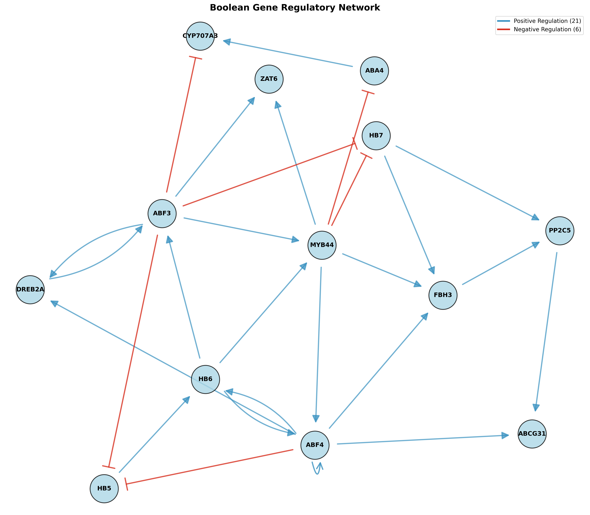
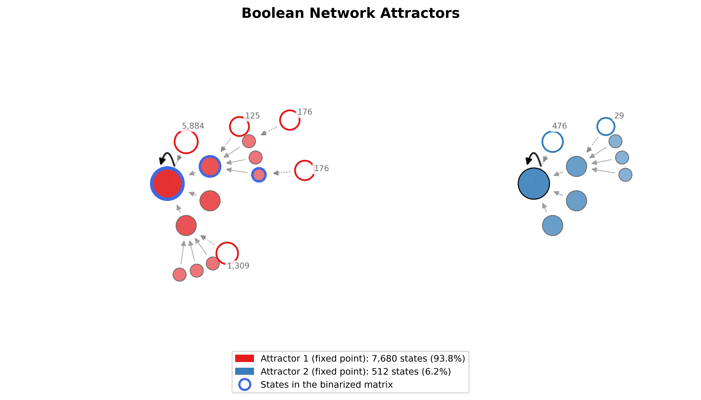
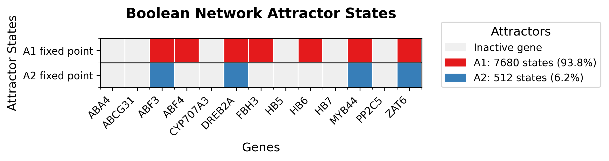
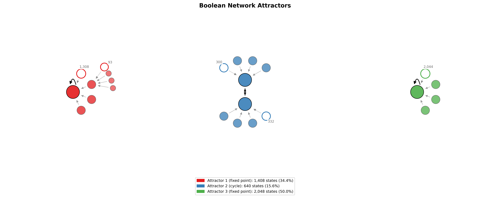
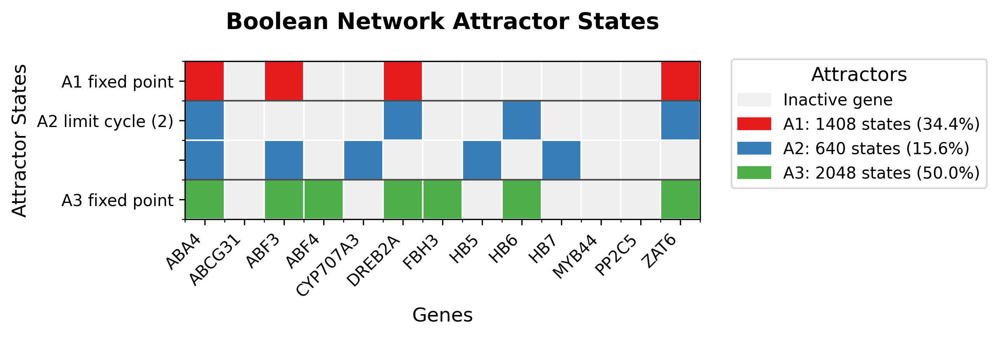
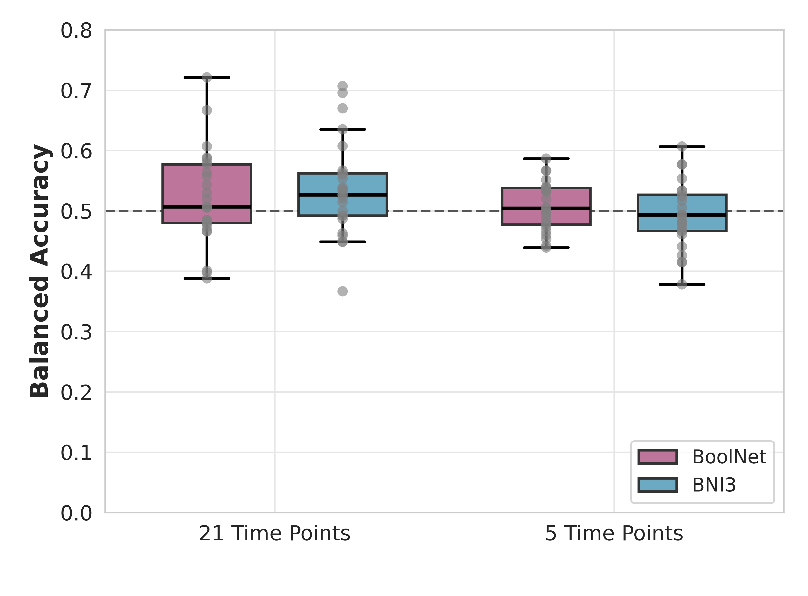
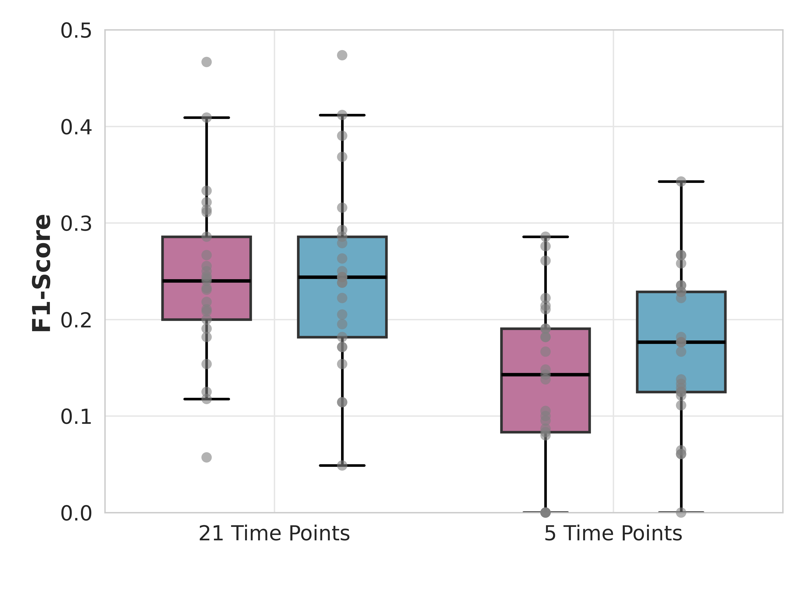
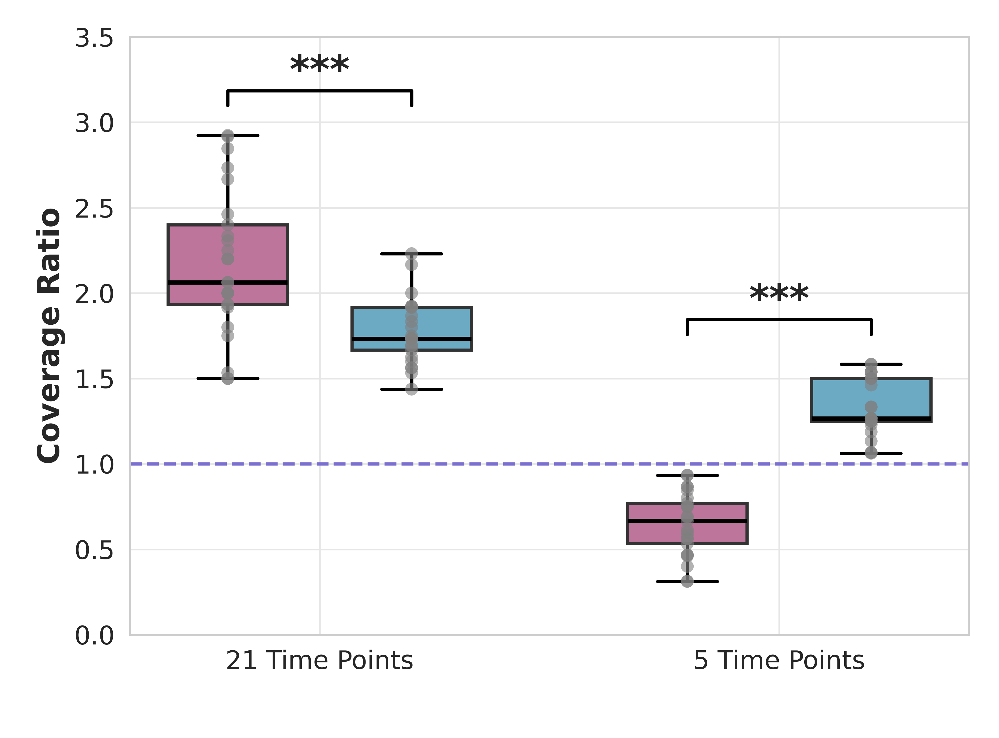
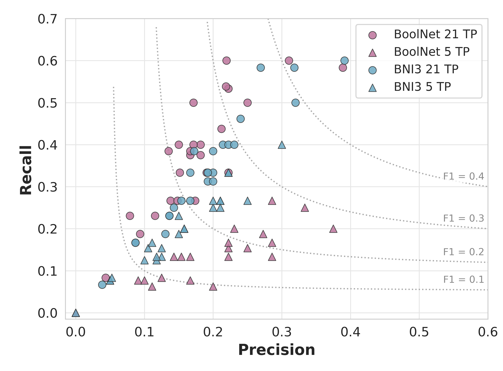

# BNI3: Boolean Network Inference and Analysis

Welcome to the **BNI3** project! BNI3 is a comprehensive pipeline designed for the binarization of gene expression data, inference of Boolean network rules, and the analysis of their dynamic attractors. This toolkit is well-suited for systems biology research, gene regulatory network (GRN) modeling, and dynamic state analysis.

## Overview

The BNI3 pipeline is structured into three main stages, each corresponding to a specific module in the project:

### 1. Binarization (`1.Binarization/`)
Continuous gene expression data (e.g., RNA-Seq counts) must be discretized into binary states (0 for inactive, 1 for active) to model them as Boolean networks. 
* **Algorithms**: **SSD** (Short Series Discretization) and **WCSS** (Within Cluster Sum of Squares).

### 2. Boolean Rules Inference (`2.Rules_Inference/`)
Infers the logical relationships (Boolean rules) between different genes/nodes over time using Gene Expression Programming (GEP).
* Evaluates inferred rules based on cycle lengths, fixed point ratios, and biological concordance.

### 3. Attractors Analysis (`3.Attractors/`)
Maps the steady states or cycles known as *attractors* (biological phenotypes). Simulates sequence transitions and visualizes topological basins.

---

## Interactive Usage Vignette

BNI3 is designed to abstract away the complexity of mathematical modeling. We provide an interactive bash launcher designed to simplify the execution of the entire pipeline using robust default settings.

### Getting Started

You can install the required dependencies using either **pip** (faster) or **Conda**.

#### Option A: Pip Virtual Environment (Recommended for speed)
```bash
# 1. Clone the repository
git clone https://github.com/lucianofrancoo/BNI3.git
cd BNI3

# 2. Create and activate a virtual environment
python3 -m venv bni3_env
source bni3_env/bin/activate

# 3. Install dependencies
pip install -r requirements.txt

# 4. Launch the Interactive Pipeline
./bni3_launcher.sh
```

#### Option B: Conda
```bash
# 1. Clone the repository
git clone https://github.com/lucianofrancoo/BNI3.git
cd BNI3

# 2. Create and activate the Conda environment
conda env create -f environment.yml
conda activate bni3_env

# 3. Launch the Interactive Pipeline
./bni3_launcher.sh
```

---

## 1. Binarization Example
Your initial continuous matrix should have **Genes as rows** and **Timepoints/Samples as columns**. Example (`Counts_lite.tsv`):

| ID | 0d | 5d | 11d | 14d |
|---|---|---|---|---|
| **HB7** | 310.66 | 197.00 | 186.66 | 47.33 |
| **ZAT6** | 157.00 | 92.00 | 414.00 | 3217.33 |
| **CYP707A3** | 472.66 | 165.33 | 717.66 | 154.66 |

Select `1` in the Main Menu. BNI3 automatically calculates transition thresholds and generates a **transposed** Binarized Matrix:

| HB7 | ZAT6 | CYP707A3 | ABCG31 | PP2C5 | DREB2A | HB6 | MYB44 |
|---|---|---|---|---|---|---|---|
| 1 | 0 | 1 | 1 | 1 | 0 | 0 | 0 |
| 1 | 0 | 0 | 0 | 0 | 0 | 1 | 0 |
| 1 | 0 | 1 | 0 | 0 | 0 | 1 | 1 |
| 0 | 1 | 0 | 0 | 0 | 1 | 1 | 1 |

---

## 2. Rules Inference & Evaluation Example

Select `2` in the Main Menu. The system will dedicate 100% of your CPU cores `$(nproc)` to evolve logical rules independently for each gene.

Example of rules inferred just for the gene **HB7**:

| Gene | Position | Rule Inferred | Correct Transitions | N_Regulators | Score |
|---|---|---|---|---|---|
| HB7 | 1 | `~ABF3 & ~MYB44` | 3 | 2 | 1.9375 |
| HB7 | 2 | `~ABF3 \| ~CYP707A3` | 3 | 2 | 1.9375 |
| HB7 | 3 | `~MYB44 \| (ABF4 & ~ZAT6)` | 3 | 3 | 1.9375 |

Because BNI3 infers *multiple* valid rules per gene, the Evaluator tests network combinations to find the best topology (`rules_by_gene_evaluated.tsv`). When the space is too large to enumerate (here 3·10¹⁵ combinations) it uses hill climbing, so a rerun can pick another of the combinations tied at the optimum. Edge colors follow the sign of each regulator in the Boolean function: blue activates, red inhibits.



---

## 3. Attractors & Biological Perturbations

Select `3` in the Main Menu to calculate steady states. The module outputs `attractors.tsv`:

| attractor_id | type | cycle_length | basin_size | basin_percentage | binary_state |
|---|---|---|---|---|---|
| 1 | fixed_point | 1 | 7680 | 93.75% | 0011011010101 |
| 2 | fixed_point | 1 | 512 | 6.25% | 0010010000101 |

Below is the steady state map for our network: two fixed points, one of which drains almost the whole state space. Rings in blue mark the states observed in the binarized matrix; hollow nodes count the states that reach the attractor through each drawn state.

<div style="display: flex; justify-content: space-around; align-items: center;">
  
  
</div>

*(Left: the attractors with the states leading into them, `--predecessors 2`. Right: the gene states of each attractor).*

### In-Silico Mutations (e.g. Knockout)
BNI3 allows you to simulate Overexpression (Gene:1) or Knockouts (Gene:0). If we simulate a Knockout of **MYB44:0**, the attractor landscape changes: three attractors appear (two fixed points and a 2-state cycle) and the dominant wild-type fixed point disappears:

<div style="display: flex; justify-content: space-around; align-items: center;">
  
  
</div>

*(Mutations are passed to every step with `-m`, e.g. `-m "MYB44:0"` or `-m "ABF4:1,MYB44:0"`, and their suffix is added to the output names).*

---

## Reproducing the paper

[`reproducibility/`](./reproducibility/) holds the data, scripts and results behind the paper: the DREAM4 size10 benchmark against BoolNet, the synthetic cell-cycle network, and the ABA response to drought in *Arabidopsis thaliana* and tomato. Its [README](./reproducibility/README.md) maps each analysis to its folder and gives the commands.

Figure 5 compares BNI3 with BoolNet on the 25 DREAM4 size10 series, with all 21 time points and reduced to 5:

<div style="display: flex; flex-wrap: wrap; justify-content: space-around;">
  
  
  
  
</div>

```bash
python3 reproducibility/DREAM4/scripts/make_figure5.py          # figure and statistics from the included results
bash reproducibility/DREAM4/scripts/run_bni3_dream4.sh          # full rerun (about two days with 50 processes)
```

The R steps (gold-standard scoring, BoolNet, DESeq2) need R with `dplyr`, `BoolNet`, `DESeq2`, `ggplot2`, `BiocParallel` and `patchwork`.

## Known issues

- `3.Attractors/BNI3_Attractorator.py`: with `-m`, the trajectory files do not get the mutation suffix, so runs of several conditions into the same folder overwrite `trajectory*`. Give each condition its own `-ob`.
- `2.Rules_Inference/4.BNI3_Boolean_network_visualizer.py`: `-o` must include a directory (`-o out/network`); a bare name fails, and `-d` is ignored when `-o` is given.
- The header of the rule-inference log prints an example MLP configuration computed for all genes as regulators. The configuration actually used is chosen per candidate rule from its own number of regulators, so `lbfgs` convergence warnings can appear even when the header says `adam`.

